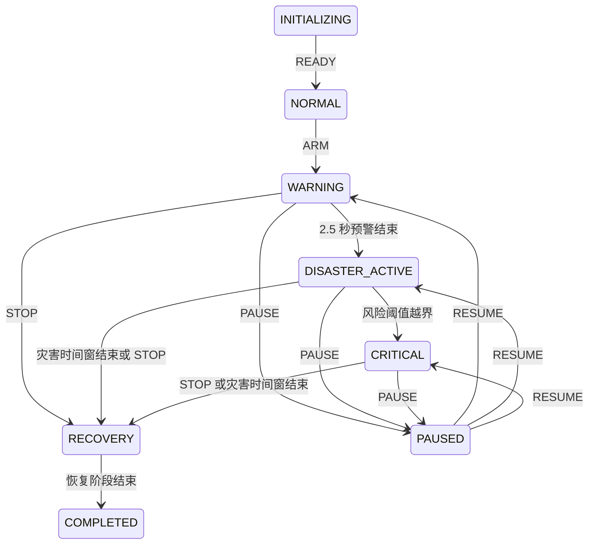

# 架构与状态机

## 同一份模型状态

`Simulation` 是运行状态的唯一写入者。面板的 `configure` 操作验证当前灾害的参数范围，将数值写入统一参数对象后同步更新模拟边界、暴露状态和 `SimulationStore`。Three.js 场景、建筑指标、图表与 UI 都从该对象派生，不维护平行的水位或损伤计数。

独立模块分别负责计算和所有权：

- `SimulationClock` 按请求的 1×／2×／5× 比例累积墙钟时间，再以 1/60 s 固定步长调用控制器；物理步数不依赖绘制调用频率。
- `FloodSimulation` 拥有 61×55 高程网格、边界水位与水深；每四个物理步执行一次 1/15 s 通量更新。
- `BuildingDamage` 计算 23 栋楼的阻尼响应、漂移需求和受损分级。`BuildingView` 只反映模型中的那份结构状态。
- `PhysicsWorld` 独占 Rapier 世界、固定步长、刚体、碰撞体、关节及统一销毁操作。
- `MetricsCollector` 对结构和水深输出采样。展示图表、状态文本和事件线都来自已提交的模型数据。

## 状态转移

`SimulationStateMachine` 验证单步和状态事件；界面没有直接修改其内部阶段。

暂停通过独立布尔状态包装有效阶段。暂停时墙钟累计和 Rapier 调用一同停止；明确发出的 `step` 只执行一帧。重置返回正常阶段并原子重建物理世界、参数和水深场。灾害切换清除上次情景的风、降雨、地震强迫量，并恢复共同城市基线。

## 检查点与回放

用户请求建立检查点时，系统以最近已发布模型快照为记录时刻，保存完整 Rapier `World.takeSnapshot()` 数据、结构刚体句柄、动态刚体目录、水深数组、时钟小数累积、状态阶段、灾害参数、结构状态、时间窗和事件样本。再恢复检查点调用 `World.restoreSnapshot()` 构造新的物理世界，连同索引、网格和 UI 数据一起恢复。

每次灾害运行都记录确定性起点、固定种子、步数及运行时改参数/停止事件。时间轴定位从起点恢复整套状态，再在已记录事件的正确模拟步执行同一计算，最终在目标帧暂停。回放取消使用运行代次，阻止较早请求提交或继续调度。报告及浏览器测试覆盖检查点的两次连续恢复。

## 资源与事件

`FrameLoop` 防止并行 RAF，过期回调使用代次号自动失效。`DisplayBindings` 保存具名监听器清理函数，并由 `Engine.dispose()` 统一解除。独立 `ResourceManager` 去重释放网格、材质、纹理、实例缓冲和灯光阴影。离屏时引擎暂停，返回后只启动一个帧循环。
